# Ajolotito Notificaciones

Aplicación Flutter desarrollada con TDD. Controla el hambre de una mascota virtual y programa avisos locales responsables, con horario silencioso, categorías configurables y permisos solicitados en contexto.

## Funciones

- Ajolotito con nivel de hambre y estado de ánimo.
- Alimentación persistente con `SharedPreferences`.
- Avisos locales nativos en Android, sin API ni servidor.
- Horario tranquilo de 22:00 a 08:00 y máximo dos avisos diarios.
- Permiso explicado antes del diálogo del sistema.
- Categorías configurables y payload validado.

## Ejecutar

```powershell
flutter pub get
flutter test
flutter emulators --launch medium_phone
flutter run -d emulator-5554
```

No se necesita llave de API. En Android 13 o superior acepta el permiso cuando la app lo solicite.

## Pruebas y fases TDD

La suite contiene 17 verificaciones automatizadas. Cada ronda documenta rojo, verde y refactor con capturas reales de Visual Studio Code y la cuenta `ValeMolina612 (GitHub)`.

### Ronda 1: Preparación del proyecto

| 🔴 Rojo | 🟢 Verde | 🔵 Refactor |
|---|---|---|
|  |  |  |

### Ronda 2: Reloj y mascota

| 🔴 Rojo | 🟢 Verde | 🔵 Refactor |
|---|---|---|
| 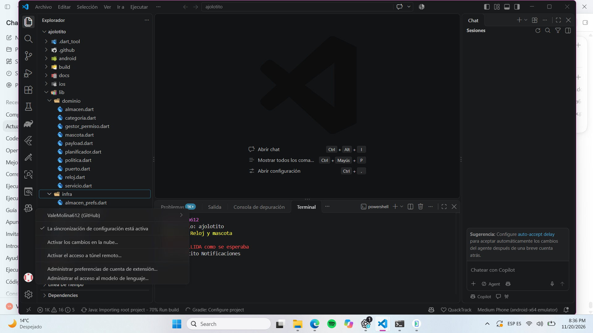 | 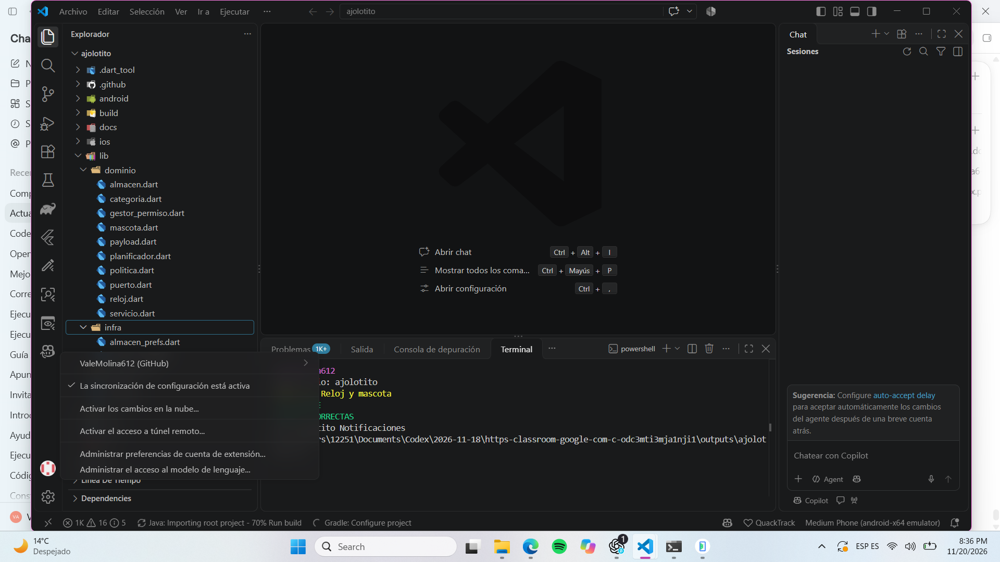 | 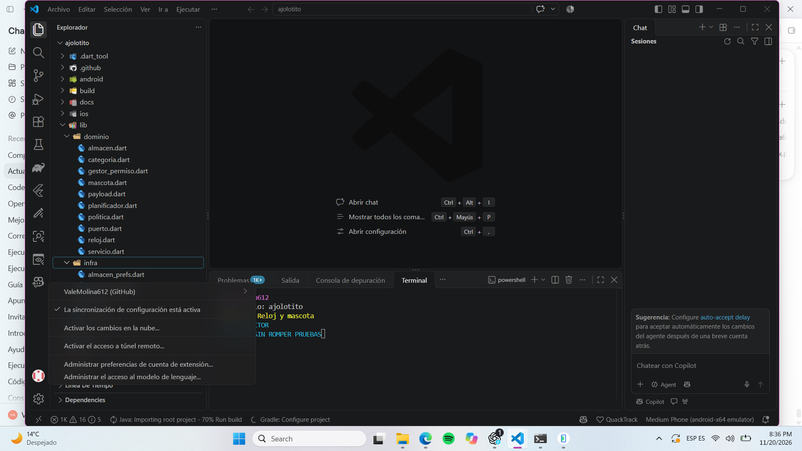 |

### Ronda 3: Categorías, canales y mensajes

| 🔴 Rojo | 🟢 Verde | 🔵 Refactor |
|---|---|---|
|  | 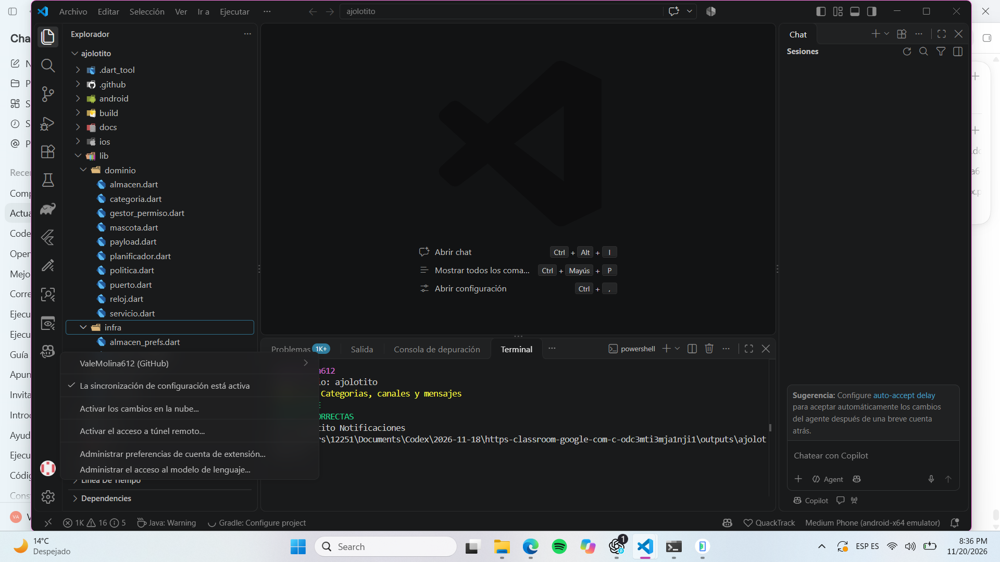 |  |

### Ronda 4: Política de horario silencioso

| 🔴 Rojo | 🟢 Verde | 🔵 Refactor |
|---|---|---|
|  |  |  |

### Ronda 5: Payload seguro

| 🔴 Rojo | 🟢 Verde | 🔵 Refactor |
|---|---|---|
| 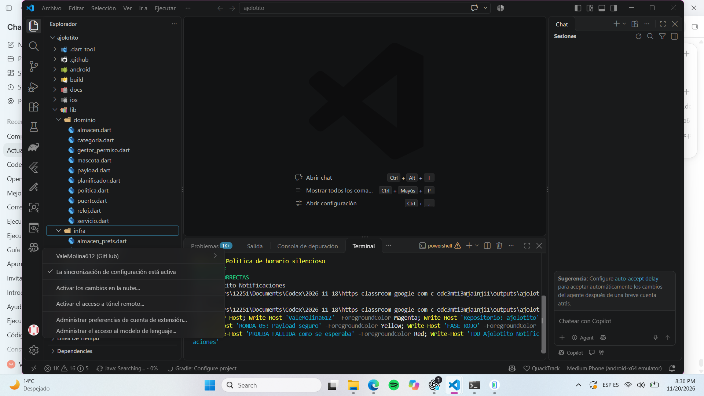 | 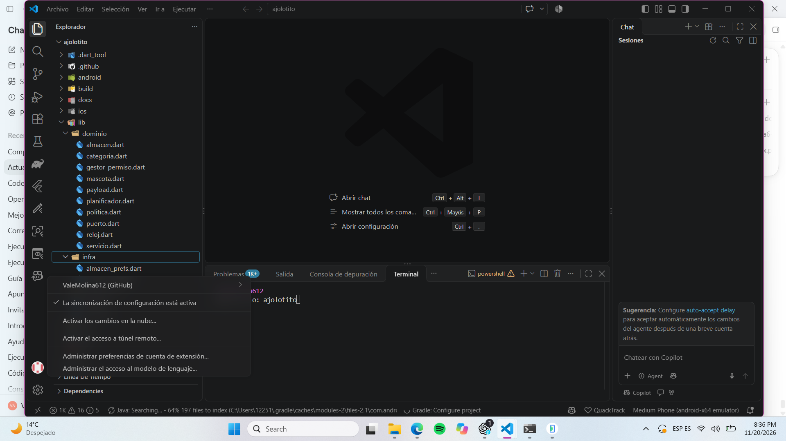 |  |

### Ronda 6: Planificador

| 🔴 Rojo | 🟢 Verde | 🔵 Refactor |
|---|---|---|
|  |  |  |

### Ronda 7: Puerto y dobles de prueba

| 🔴 Rojo | 🟢 Verde | 🔵 Refactor |
|---|---|---|
| 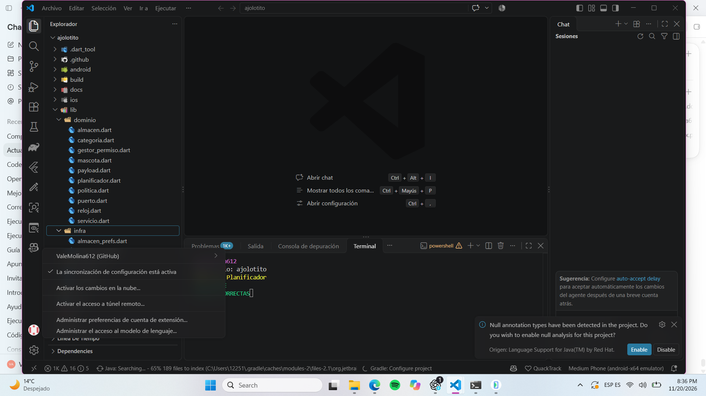 |  |  |

### Ronda 8: Permiso responsable

| 🔴 Rojo | 🟢 Verde | 🔵 Refactor |
|---|---|---|
|  |  |  |

### Ronda 9: Servicio y sincronización

| 🔴 Rojo | 🟢 Verde | 🔵 Refactor |
|---|---|---|
|  |  |  |

### Ronda 10: Adaptador Android real

| 🔴 Rojo | 🟢 Verde | 🔵 Refactor |
|---|---|---|
|  |  |  |

### Ronda 11: ViewModel y pantallas

| 🔴 Rojo | 🟢 Verde | 🔵 Refactor |
|---|---|---|
| 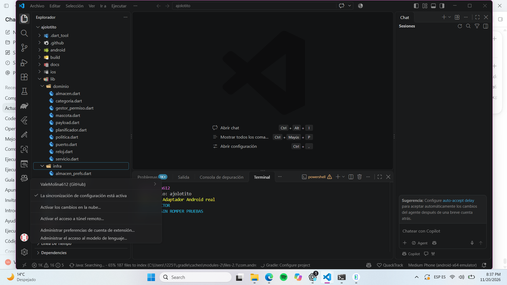 |  |  |

### Ronda 12: Ejecución en Android

| 🔴 Rojo | 🟢 Verde | 🔵 Refactor |
|---|---|---|
| 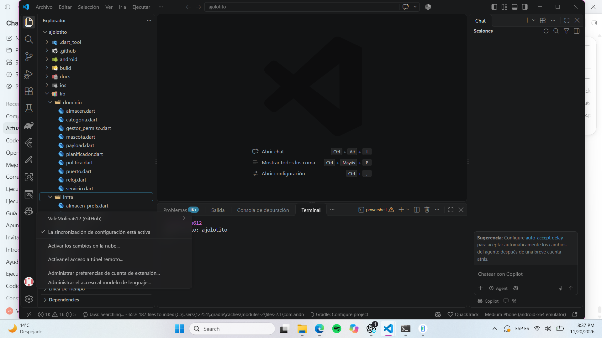 | 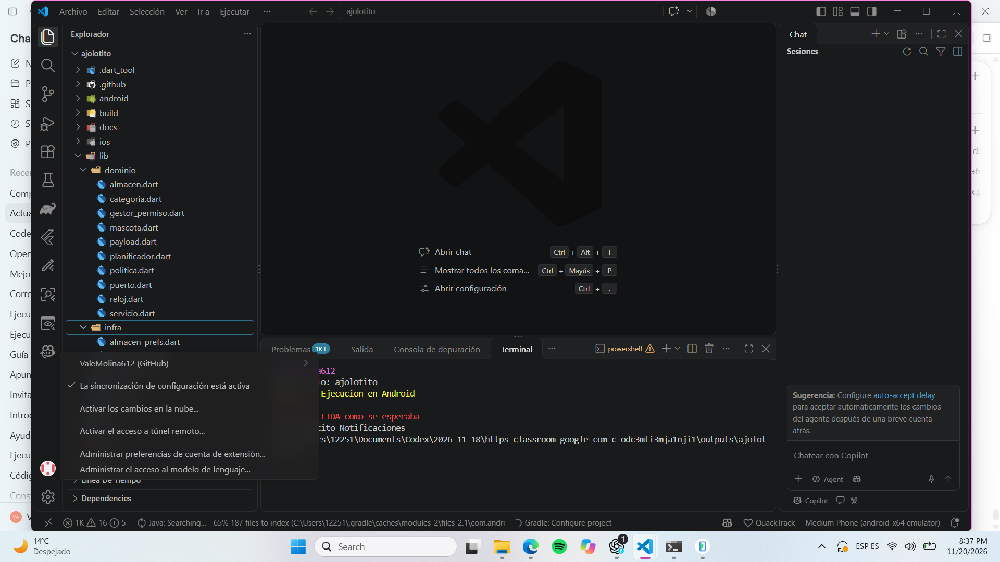 |  |

### Ronda 13: Diseño extensible para push remoto

| 🔴 Rojo | 🟢 Verde | 🔵 Refactor |
|---|---|---|
|  |  | 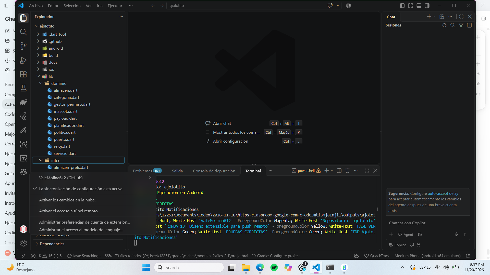 |

## APK

```powershell
flutter build apk --debug
```

Salida: `build/app/outputs/flutter-apk/app-debug.apk`.

